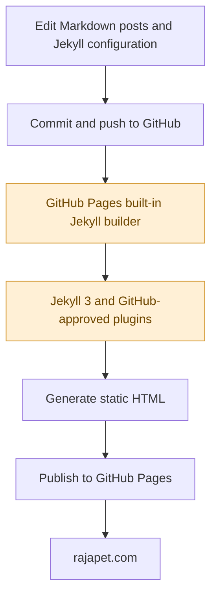
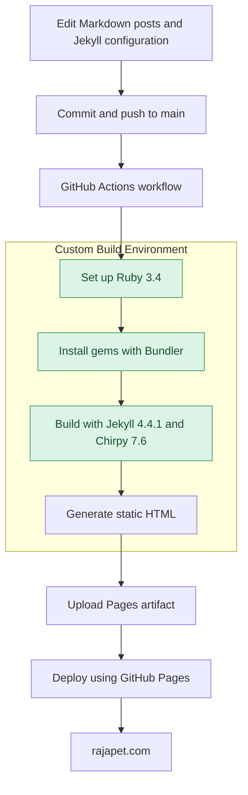

I've been running my personal blog, [rajapet.com](https://rajapet.com), on [Jekyll](https://jekyllrb.com/) and [GitHub Pages](https://docs.github.com/en/pages/getting-started-with-github-pages/what-is-github-pages) for a few years. It has 626 posts going all the way back to 2005, and until recently, it was using the Minimal Mistakes theme.

The blog has been through a few changes over the years. I started with Blogger ([still live](https://anotherlab.blogspot.com/)), went through a couple of WordPress incarnations (they are 100% gone), and eventually settled on Jekyll. Along the way, I accumulated a fair amount of cruft.

The site still worked, but I was stuck on an older version of Jekyll. GitHub Pages' built-in Jekyll support is limited to version 3, and I wanted to move to Jekyll 4. I also wanted a new theme.

I figured I'd update the theme, clean up some old stuff, and be done with it. Naturally, it turned into a bigger project.

By the time I finished, I'd upgraded Jekyll, replaced the theme, changed how the site builds and deploys, and discovered that 111 of my old post URLs had changed. That last one was particularly annoying because the permalink configuration hadn't changed at all.

Here's what I did and what I ran into along the way.

## The Starting Point

The original blog was running with the following configuration:

| Component | Original |
|---|---|
| Static site generator | Jekyll 3.9.5 |
| Theme | Minimal Mistakes 4.26.2 |
| Hosting | GitHub Pages |
| Build process | GitHub Pages built-in Jekyll |

My development environment was Ubuntu running under WSL2 on Windows 11. The tools generally prefer Linux, and WSL2 makes that easy enough.

The production site lived in a GitHub repository, with GitHub Pages serving it through my custom domain, `rajapet.com`.

I had three goals:

1. Upgrade from Jekyll 3 to Jekyll 4.
2. Replace Minimal Mistakes with the Chirpy theme.
3. Keep every existing post URL working so old links, search engine results, and Giscus comments wouldn't break.

I expected the third one to be straightforward. It wasn't.

## Step 1: Build the New Site Separately

I didn't want to mess with the working site while figuring out the migration, so I created a separate directory.

My original Jekyll project was in:

```text
~/blog/old-site
```

The new project was built in:

```text
~/blog/blog-migration
```

I also created a separate Chirpy starter project so I could poke around the theme's structure and configuration.

This gave me two working builds to compare without touching production.

The old site's generated HTML was available in:

```text
~/blog/old-site/_site
```

The new site's generated HTML was available in:

```text
~/blog/blog-migration/_site
```

Having both builds sitting there turned out to be very useful, especially when I started comparing URLs.

## Step 2: Configure Jekyll 4 and Chirpy

The new site uses Jekyll 4.4.1 and Chirpy 7.6.

Chirpy is structured differently from Minimal Mistakes, so changing the theme name in `_config.yml` wasn't going to cut it.

I needed to move my existing posts and assets into the new project while adopting Chirpy's configuration and layout conventions.

The important site settings included:

```yaml
url: "https://rajapet.com"
baseurl: ""
timezone: America/New_York

permalink: /:year/:month/:day/:title/
```

The permalink format mattered because my existing posts had URLs like:

```text
https://rajapet.com/2005/10/26/example-post/
```

Those addresses needed to stay exactly where they were.

I also carried over the custom domain and favicon configuration.

### Why I Chose Chirpy

[Minimal Mistakes](https://mmistakes.github.io/minimal-mistakes/) served me well for the last few years. It's a mature, highly configurable theme that can handle all sorts of sites. For a long time, it did everything I needed.

But I wanted something that looked a little more modern and was geared toward technical writing.

[Chirpy](https://chirpy.cotes.page/) caught my attention for a few reasons:

* Built-in dark and light modes, with a toggle that remembers the reader's preference. At least in the version of Minimal Mistakes I was using, that wasn't available out of the box.
* Native [Mermaid](https://mermaid.ai/open-source) support for architecture diagrams and flowcharts. And I used Mermaid with this blog post.
* Clean source code formatting, syntax highlighting, and copy buttons. For this blog, that's worth the price of admission.
* Pinned posts for articles I want to keep visible.
* Better navigation for categories, tags, and chronological archives. I like this quite a bit more than what I had with Minimal Mistakes.
* Progressive Web App support.
* A responsive layout built specifically for technical blogs. Which is pretty much what this site is.
* The AI Overlord who assisted in the migration suggested Chirpy when I asked it if there was a better theme for my blog.

Some of this was possible with Minimal Mistakes, but it meant more configuration or customization.

Chirpy already had most of what I wanted, so I wouldn't need to maintain a bunch of custom templates and plugins.

There is a trade-off. Minimal Mistakes is more flexible if you're building different kinds of pages. Chirpy has stronger opinions about what a technical blog should look like.

I'm fine with that.

When I used WordPress for this blog, I probably used about 1% of its functionality. I don't need another system with a thousand options I'll never touch. And being on the constant watch for security issues. Getting [hacked once](/2017/02/21/and-then-my-blog-was-defaced/) through WordPress was enough. WordPress is find CMS platform. I just don't need a CMS platform.

### Preserving the comments

My blog uses Giscus for comments, with discussions stored in a GitHub repository. It's there because it was easy to add.

I moved the Giscus configuration into Chirpy:

```yaml
comments:
  provider: giscus
  giscus:
    repo: "YOUR_GITHUB_USERNAME/YOUR_REPOSITORY"
    repo-id: "YOUR_REPOSITORY_ID"
    category: "Comments"
    category-id: "YOUR_CATEGORY_ID"
    mapping: "pathname"
    reactions-enabled: "1"
    theme: "light"
    crossorigin: "anonymous"
```

The repository name and identifiers in this example are placeholders.

The setting to pay attention to is `mapping: "pathname"`.

Giscus uses the page's path to find the associated discussion. If a post moves to a different URL, its existing comments may no longer show up.

So keeping the URLs intact mattered for more than just old bookmarks and search results.

## Step 3: Migrate the Existing Content

Next came the 626 Markdown posts.

These posts span more than 20 years, which means they're a mixture of Markdown, HTML, images, and links. Some were originally written for Blogger, others for WordPress, and plenty for Minimal Mistakes.

There was stuff that no longer worked, stuff that somehow still worked for reasons I couldn't explain, and a fair amount of useless crap.

I wasn't interested in rewriting 20 years of blog posts. I just wanted the content to survive the move without dragging along every bit of old baggage.

I used a combination of manual editing and some custom Python code to clean up the worst offenders.

Once the posts and assets were in place, I built the new site locally:

```bash
bundle exec jekyll build
```

For interactive testing, I used:

```bash
bundle exec jekyll serve --watch --livereload
```

That served the blog at `http://localhost:4000` and automatically rebuilt pages whenever I changed a post or template.

So far, so good.

## Step 4: Discovering That 111 Old URLs Had Changed

This was the biggest surprise of the migration.

Both sites used the same permalink pattern:

```yaml
permalink: /:year/:month/:day/:title/
```

I assumed that meant the generated URLs would be identical.

Wrong.

I wrote a script to compare the URLs generated by the Jekyll 3 and Jekyll 4 builds. Out of 626 posts, **111 had different URLs**.

Every affected post had shifted by one day.

A post that originally had one date in its URL could now appear under the preceding date.

The problem came down to differences in how the two Jekyll versions interpreted post dates and time zones, particularly for older posts.

I had expected some theme-related cleanup. I hadn't expected Jekyll to start moving posts around on the calendar.

### Why the permalink setting didn't fix it

The permalink pattern tells Jekyll how to construct the URL, but Jekyll still needs to determine the values for `:year`, `:month`, and `:day`.

If the date gets interpreted differently, the URL changes.

I already had the time zone configured:

```yaml
timezone: America/New_York
```

That didn't fix it.

Neither did adjusting the global permalink configuration.

At that point, I decided to stop fighting the date handling and just tell Jekyll exactly where those posts belonged.

### The solution: Explicit permalinks

I added an explicit `permalink` value to the YAML front matter of each affected post.

For example:

```yaml
---
layout: post
title: "An Older Blog Post"
date: 2005-10-26
permalink: /2005/10/26/an-older-blog-post/
---
```

With an explicit permalink, Jekyll doesn't need to figure out the URL from the post's date. It uses the address I gave it.

I wrote a Python script to update the 111 affected Markdown files, using the original Jekyll 3 URLs as the reference.

This solved several problems at once:

- The public URLs stayed the same.
- I didn't have to change the original publication dates.
- Jekyll's date interpretation no longer affected those URLs.
- Existing links and Giscus pathname mappings continued to work.

After updating the files, I ran the comparison again.

**All 626 post URLs matched the original site.**

That was a relief. Breaking links to posts that have been around for 20 years wasn't something I wanted to explain away as part of a theme upgrade.  I was expecting more work.  I had to do more conversion related stuff going from Blogger to WordPress, then going from WordPress to Jekyll.  The permalink format is basically there to match what Blogger (or maybe it was Wordpress) used.

## Step 5: Fix Internal Links and Validate the Site

With the URLs sorted out, I moved on to checking the generated HTML.

I used [HTMLProofer](https://github.com/gjtorikian/html-proofer), a Ruby-based tool that checks HTML output for problems such as broken internal links.

I'd never used HTMLProofer before this migration. It's separate from Jekyll, and I wish I'd discovered it sooner. It found eight internal links that needed fixing. I corrected those, rebuilt the site, and ran the checks again.

The final results were:

- All 626 original post URLs preserved.
- The eight broken internal links corrected.
- HTMLProofer checks passing.
- The production Jekyll build completing successfully.

HTMLProofer caught invalid internal references in the generated `<a>` links that I probably would have missed by clicking around the site manually.

And with 626 posts, manually checking everything wasn't going to happen.

I've since made HTMLProofer part of the build workflow so these sorts of errors can be caught before they go live.


## Step 6: Why GitHub Pages Needed a Different Deployment Process

The old site used [GitHub Pages'](https://docs.github.com/en/pages) built-in [Jekyll support](https://docs.github.com/en/pages/setting-up-a-github-pages-site-with-jekyll/about-github-pages-and-jekyll).

One of the nice things about GitHub Pages is that you can push your Jekyll source to a repository and GitHub handles the build and publishing.

It's convenient, and it's free.

Of course, there's a catch.

The built-in environment uses a restricted set of dependencies, historically centered on Jekyll 3.9.x and the `github-pages` gem.

That meant I was stuck with an older version of Jekyll. I was also limited to the plugins [white-listed by GitHub](https://docs.github.com/en/pages/setting-up-a-github-pages-site-with-jekyll/about-github-pages-and-jekyll).

I can't complain too loudly about a free service, but those restrictions were getting in the way.

The updates to Jekyll 4.4.1 and Chirpy 7.6 needed a build environment where I could control the Ruby version, dependencies, and build commands.

GitHub Actions was the obvious solution.

### The original GitHub Pages process

The original deployment worked approximately like this:



GitHub controlled the build environment and which Jekyll dependencies were supported.

For a simple site, that's great. For a site where I want to run newer versions of Jekyll and use different plugins, it's limiting. It's a blackbox, you don't see what is going on behind the current. You just hope it works. And it usually does.

### The new GitHub Actions process

With GitHub Actions, the process becomes:



GitHub Pages still hosts the site. The difference is that GitHub Actions builds it.

I didn't need to move the blog to another hosting provider or change how visitors access it. I just needed to take control of the build.

That's fine with me. I do this sort of thing at my day job anyway.

### The deployment workflow

The workflow lives in:

```text
.github/workflows/pages-deploy.yml
```

Technically, the Chirpy starter project generated the deployment workflow for me. I didn't have to create the whole thing from scratch. But whatever.

The workflow runs whenever changes are pushed to `main`.

It sets up Ruby 3.4, installs the Bundler dependencies, builds the site, and deploys the generated files to GitHub Pages using GitHub's deployment actions.

It also checks out Git submodules because Chirpy uses assets in the `assets/lib` submodule.

I committed `Gemfile.lock` to the repository so the dependency versions are reproducible.

Now I can upgrade Jekyll, Chirpy, and supporting gems without waiting for GitHub Pages to catch up.

And when something breaks in the workflow, I can see exactly where it failed instead of trying to figure out what GitHub's built-in build process didn't like.

### GitHub Pages configuration

After setting up the workflow, I changed the repository's GitHub Pages publishing source to **GitHub Actions**.

That replaced the old branch-based publishing configuration.

I verified the setting with the [GitHub CLI](https://cli.github.com/):

```bash
gh api repos/YOUR_GITHUB_USERNAME/YOUR_REPOSITORY/pages \
  --jq '{build_type, source}'
```

The result confirmed:

```json
{
  "build_type": "workflow"
}
```

GitHub Pages now publishes whatever the Actions workflow builds, instead of running its own Jekyll build.

## Step 7: Deploy Through a Pull Request

I did the migration on a separate Git branch:

```text
chirpy-migration
```

That kept the existing production site untouched while I worked through the changes.

Once the Jekyll build, URL comparisons, and HTMLProofer checks passed, I pushed the branch and opened a pull request.

The PR contained the Jekyll 4 upgrade, Chirpy theme, migrated posts, configuration changes, and GitHub Actions workflow.

After one final round of validation, I merged it into `main`.

GitHub Actions kicked off, built the site, and deployed it successfully.

At that point, the production blog was running Jekyll 4.4.1 and Chirpy 7.6.

## Step 8: Finishing the Visual Details

After deployment, I noticed that my avatar and favicon weren't displaying correctly.

Nothing like finishing a migration, opening the new site, and immediately noticing that a couple of images are missing.

Fortunately, these were easy fixes.

### Avatar

I copied my avatar image into:

```text
assets/img/avatar.jpg
```

Then configured Chirpy to use it:

```yaml
avatar: /assets/img/avatar.jpg
```

I replaced the avatar with a new image, but you get the picture.

I rebuilt the site and checked the local preview to make sure it showed up.

### Favicon

Chirpy keeps its favicon assets under:

```text
assets/img/favicons/
```

I updated those files so the site would use my favicon instead of the default Chirpy branding.

One thing to remember: browsers cache favicons pretty aggressively.

If you change a favicon and it looks like nothing happened, try a private browser window before spending half an hour debugging something that already works.

That was the bare minimum support for favicons. To do this right, I need to support multiple browsers, device types, and PWA support. That's for another day.

## Step 9: Organize the Posts by Year

Once the migration was finished, I decided to clean up one more thing.

All 626 Markdown posts were sitting in a single `_posts` directory.

That had become a pain to navigate, especially when looking for something written 15 or 20 years ago. I use VS Code to maintain this blog and scrolling through 600+ files in the Explorer Tree was annoying.

Jekyll supports subdirectories inside `_posts`, so I organized the files by publication year:

```text
_posts/
├── 2005/
├── 2006/
├── 2007/
...
├── 2025/
└── 2026/
```

I wrote a Python script to create the directories and move each post into the appropriate folder based on the year in its filename.

The filenames and contents stayed the same.

Since my URLs use dates and don't include `:categories`, moving the files into subdirectories doesn't require changing their public addresses.

The repository is much easier to browse now.

There are a couple of things to watch for if you do this yourself. Jekyll's `post_url` tag may need the subdirectory included after a move. And any scripts that assume every post lives directly under `_posts` may need updating.

## Lessons Learned

A few things are worth remembering if you're planning a similar migration.

### 1. Don't assume a Jekyll upgrade preserves URLs

I had the same permalink configuration in both versions and still ended up with 111 changed URLs.

If your site has been around for a while, compare the generated URLs before deploying. Don't assume matching configuration files mean matching output.

### 2. Explicit permalinks are useful for historical content

Adding explicit permalinks to the affected posts solved the date problem without changing the original publication metadata.

For old posts with established URLs, I'd rather specify the address than depend on how a newer version of Jekyll interprets a date.

### 3. Keep the original and new builds available

Having both `_site` directories made it easy to compare what Jekyll actually generated.

That was far more useful than staring at configuration files and assuming they should produce the same results.

### 4. GitHub Pages hosting and GitHub Pages building are different things

I still use GitHub Pages to host the blog.

GitHub Actions just gives me control over how the site is built.

I get to choose the Ruby and Jekyll versions, manage my own dependencies, and see what's happening when a build fails.

### 5. Automate validation

There was no way I was going to manually compare 626 URLs or click through every old post looking for broken links.

A small Python script and HTMLProofer caught the problems for me.

Both are worth having in the workflow.

### 6. Migrate on a branch

Doing the work on a separate branch meant I could experiment, break things, and fix them without affecting the live site.

The pull request also gave me a clean point to review everything before deployment.

After all that, here's where I ended up:

| Component | Original | New |
|---|---|---|
| Static site generator | Jekyll 3.9.5 | Jekyll 4.4.1 |
| Theme | Minimal Mistakes 4.26.2 | Chirpy 7.6 |
| Hosting | GitHub Pages | GitHub Pages |
| Build process | GitHub Pages built-in Jekyll | GitHub Actions |

### 7. Do not force HTTPS validation
When I started this blog, HTTP was still common. While in 2026 no one should be using HTTP, it was common 20 years ago. Since I moved the posts to folders by year, I may add a second HTLMProofer rule to force HTTPS validation on any new posts.

Speaking of older posts, I discovered that many of the posts are no longer valid. The Internet is not permanent. Some links are gond, others have newer owners. Two weeks ago I was contacted by some org because they no longer owned the domain for a link I had referenced. Their email request was obnoxious, so I just removed all references to the link and their org.

## What's next

I should address the favicon issue and probably regenerate a new site icon.  I'll make sure it's valid for browsers running in both light and dark mode. It's kinda surprising that popular sites have icons that look awful in dark mode.

And I'll probably make some attempt to meet standard WCAG accessbility standards. I don't think this version of Chirpy meets WCAG AA, but I'll see if I can adjust it. Light mode is probably OK, but dark mode isn't.

## Final Thoughts

The blog is now running Jekyll 4.4.1 with Chirpy 7.6, and I'm happy with how it turned out.

It's still hosted on GitHub Pages at [rajapet.com](https://rajapet.com), but GitHub Actions handles the build. I can upgrade Jekyll and its dependencies on my own schedule, and the site has a cleaner layout that's better suited to the technical stuff I tend to write.

Best of all, all 626 original post URLs more or less survived.

I went into this expecting a theme upgrade and some cleanup. I ended up dealing with date handling, permalink compatibility, a new deployment workflow, and 20 years of accumulated cruft.

The actual Jekyll upgrade wasn't particularly difficult. Making sure I didn't break two decades of old content took most of the work.

I'm glad I did it, though. The blog looks better, the build process is easier to manage, and I finally got rid of a bunch of stuff that had been hanging around since the Blogger and WordPress days.

## About the Cover Image

You might be wondering what the strange figure in the cover image has to do with migrating a blog from Jekyll 3 to Jekyll 4.

Absolutely nothing.

My wife and I spotted this thing while we were out house shopping with our daughter.

It was standing in a field of tall grass, arms raised, with a strangely realistic-looking head. We had no idea what it was supposed to be, but it was weird enough that we stopped and took a picture.

I still don't know what its original purpose was. I just thought it was odd and kind of cool. That was the best part of that house.

After spending all that time moving 20 years of blog posts around, I figured the new site deserved an equally strange cover image.
